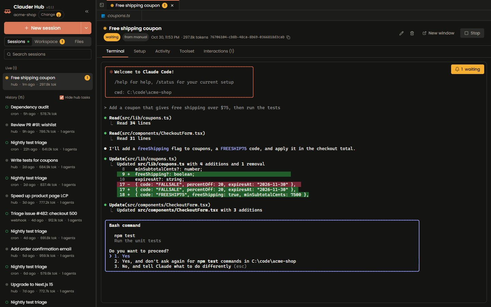
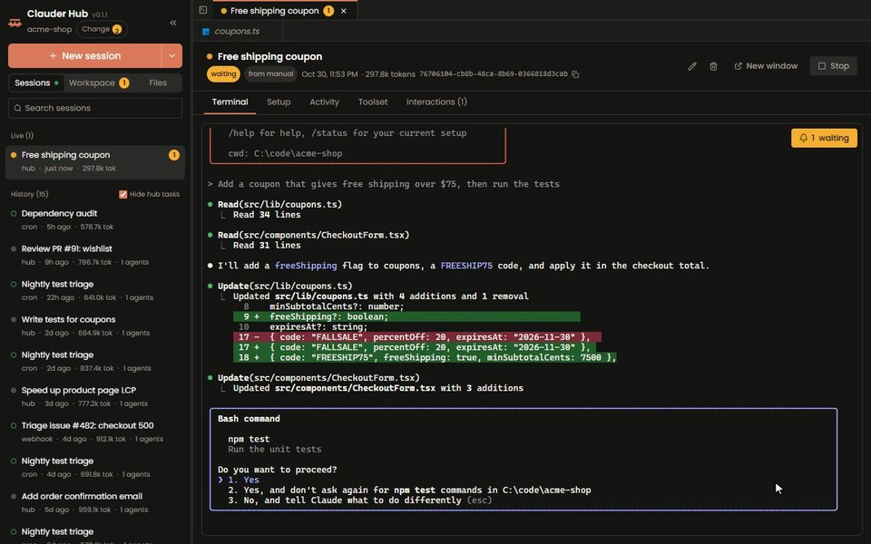
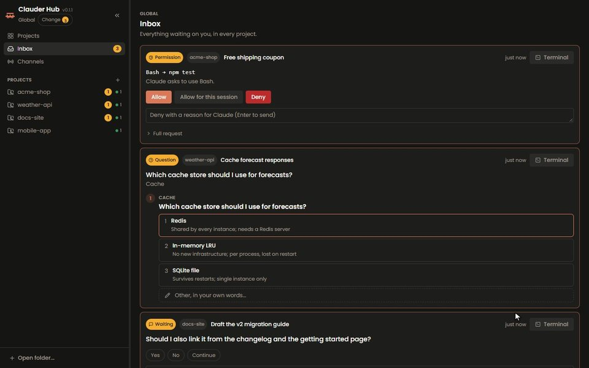
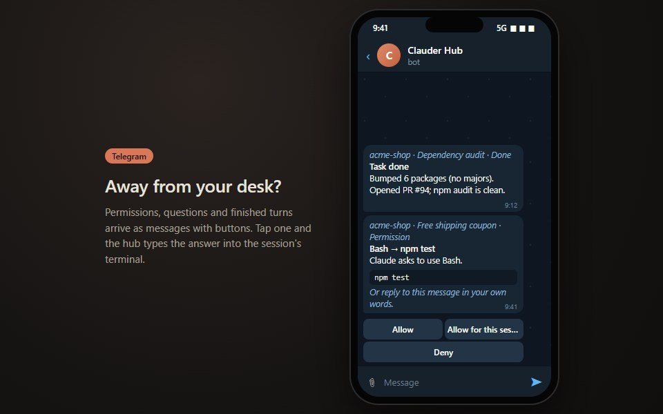
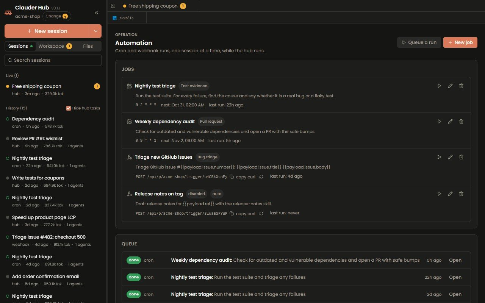
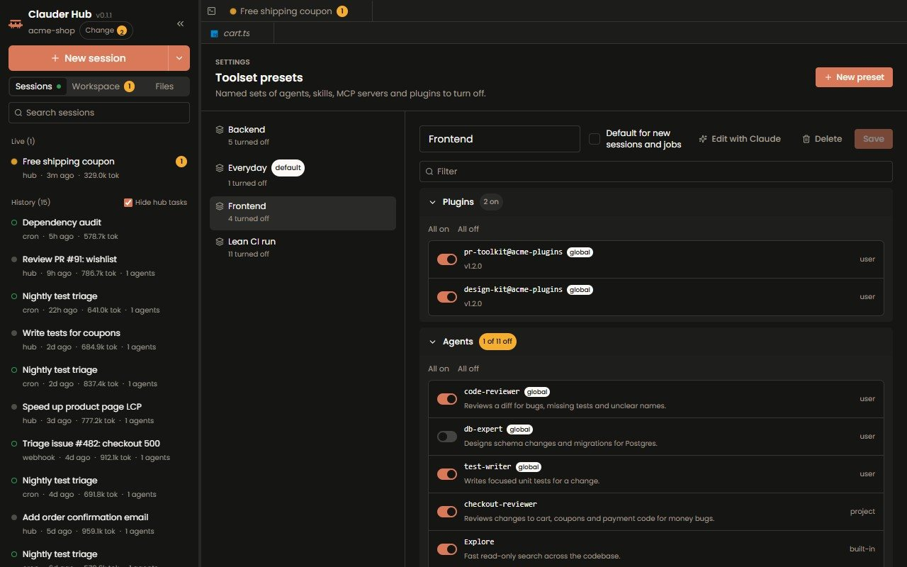
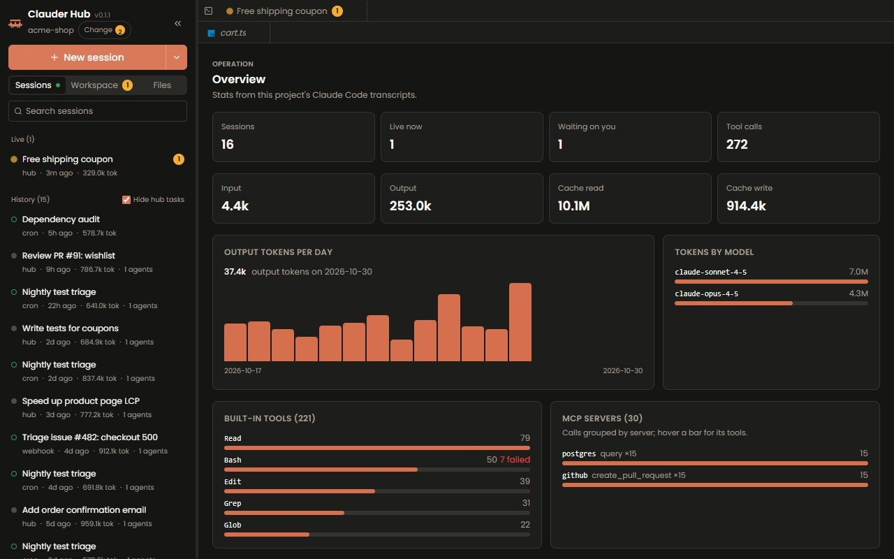
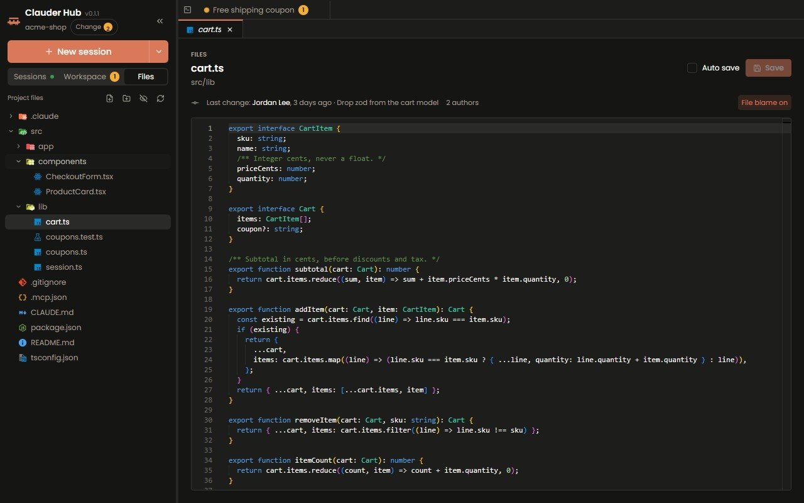

<h1 align="center">
  <a href="https://github.com/goldyndevs/clauder-hub"></a>
  <br>
  Clauder Hub
</h1>

<p align="center">
  <a href="https://www.npmjs.com/package/clauder-hub"></a>
  <a href="https://www.npmjs.com/package/clauder-hub"></a>
  <a href="LICENSE"></a>
  <a href="https://nodejs.org"></a>
  <a href="https://github.com/goldyndevs/clauder-hub/stargazers"></a>
</p>

<p align="center">
  <b>Every Claude Code session on your machine, in one browser tab.</b><br>
  A handy ADE and wrapper around Claude Code.
</p>

<p align="center">
  
</p>

<p align="center">
  <code>npx clauder-hub .</code>
</p>

---

## Features

Clauder Hub runs the real `claude` you already use, in real terminals, and adds what one terminal window cannot: every project at once, an inbox of everything Claude is waiting on, answers from your phone, scheduled runs and stats. Nothing is reimplemented and nothing is installed into Claude Code.

<table>
  <tr>
    <td width="40%">
      <h3>Real terminals, live activity</h3>
      <b>New session</b> opens a plain <code>claude</code> in an embedded xterm. Close the tab and it keeps running; every tool call, token and subagent is read from the transcripts as it goes.
    </td>
    <td width="60%">
      <picture>
        <source srcset="docs/assets/terminal.webp" type="image/webp">
        
      </picture>
    </td>
  </tr>
  <tr>
    <td>
      <h3>One inbox for every project</h3>
      Permissions, questions and finished turns from all your projects land in one place, with buttons. The answer is typed into the terminal, and the first answer from anywhere wins.
    </td>
    <td>
      <picture>
        <source srcset="docs/assets/inbox.webp" type="image/webp">
        
      </picture>
    </td>
  </tr>
  <tr>
    <td>
      <h3>Answer from your phone</h3>
      Telegram and Slack bots relay every question with inline buttons, and BotFather-style commands (<code>/new</code>, <code>/sessions</code>, <code>/summary</code>, <code>/stop</code>) drive sessions from chat. No public URL needed.
    </td>
    <td>
      <picture>
        <source srcset="docs/assets/telegram.webp" type="image/webp">
        
      </picture>
    </td>
  </tr>
  <tr>
    <td>
      <h3>Cron, webhooks and a queue</h3>
      Nightly test triage, weekly dependency audits, a run per new GitHub issue. Each project has one queue, and a task category defines what "done" means before a run may close.
    </td>
    <td>
      
    </td>
  </tr>
  <tr>
    <td>
      <h3>Toolsets and presets</h3>
      Turn agents, skills, MCP servers and plugins off for one session, or save the choice as a preset for jobs and new sessions. Applied through that session's own <code>--settings</code>, nothing else.
    </td>
    <td>
      
    </td>
  </tr>
  <tr>
    <td>
      <h3>Stats from the transcripts</h3>
      Tokens by day and by model, built-in tools, MCP servers, skills and subagents, per project and per session. Parsed from the JSONL Claude Code already writes, so it costs nothing.
    </td>
    <td>
      
    </td>
  </tr>
  <tr>
    <td>
      <h3>Files and editor</h3>
      A file tree and a Monaco editor with tabs sit beside your sessions, with GitLens-style blame from <code>git blame</code>, so you can check what Claude changed without leaving the page.
    </td>
    <td>
      
    </td>
  </tr>
</table>

**Also in the box:**

- **The global page.** A card per project with what is running, waiting and queued, plus one global bot that tags each message with its project (`/projects`, `/use`, `/addproject`).
- **No forms.** Creating a job, a run, a category, a preset or a channel opens a Claude session for it: Claude asks, shows the JSON and saves it after your yes.
- **Natural-language fallbacks.** Misspell a command or describe a session ("the one fixing the login bug") and a small Haiku call offers its guesses as buttons. Nothing runs until you press one.
- **Prompts, memory and inventory.** Edit every word the hub adds to a session, edit `CLAUDE.md`, rules, agents and skills after a diff, and see every agent, skill, command, MCP server, hook and plugin by scope.
- **MCP suggestions.** A session blocked on a missing integration says so; `claude mcp add --scope project` runs only when you approve it.
- **Desktop notifications** on Windows, macOS and Linux, and webhooks to Discord, Teams or your own endpoint.
- **Local only.** The server listens on `127.0.0.1`. Hooks are answered `{}` at once, so the hub can never approve or block a tool call by itself.

---

## Install

**Requirements:** Node.js 22 or newer, and [Claude Code](https://docs.claude.com/en/docs/claude-code) installed and signed in (`claude` on your PATH).

```bash
npx clauder-hub .              # the current folder
npx clauder-hub ~/code/my-app  # or any project folder
```

Or keep it installed:

```bash
npm i -g clauder-hub
clauder-hub .
```

Open **http://localhost:4329**. If the port is taken the next free one is used (`--port <n>` picks one). The hub remembers its projects, so later runs can be just `clauder-hub`; running it again with another folder adds that folder to the hub already running. `clauder-hub --help` lists the options.

Data lives in `~/.clauder-hub` (`CLAUDER_HUB_HOME` moves it): the project list, one database per project, and per-terminal settings files.

---

## Developing

```bash
git clone https://github.com/goldyndevs/clauder-hub.git
cd clauder-hub
npm install
npm run dev -- /path/to/a/project   # server and web with reload
```

`npm run typecheck` and `npm run build` before a pull request. See [CONTRIBUTING.md](CONTRIBUTING.md) and [CLAUDE.md](CLAUDE.md) for how the code is laid out and the rules it keeps.

---

## FAQ

**Does it replace Claude Code?**
No. It runs the `claude` you already have, with your login, settings and plugins, in a real terminal.

**Does it write anything into my Claude Code setup?**
No. Hooks and the extra system prompt are passed per process with `--settings` and `--append-system-prompt-file`. The only exceptions are ones you ask for by name: a suggested `claude mcp add --scope project`, or saving an instruction file after its diff.

**Do I need a public URL for Telegram or Slack?**
No. Telegram uses long polling and Slack uses Socket Mode, both outgoing connections.

**What happens when I close the browser?**
Sessions keep running in the hub. Reopen the page and attach again.

**Can it see sessions I started in a normal terminal?**
Yes, with their stats. Resume one in the hub to answer it from the inbox or a channel.

**Does it cost extra tokens?**
Stats and `/summary` are read from transcripts. Only the natural-language fallbacks in channels make a small Haiku call.

---

## License

[MIT](LICENSE) © goldyndevs
